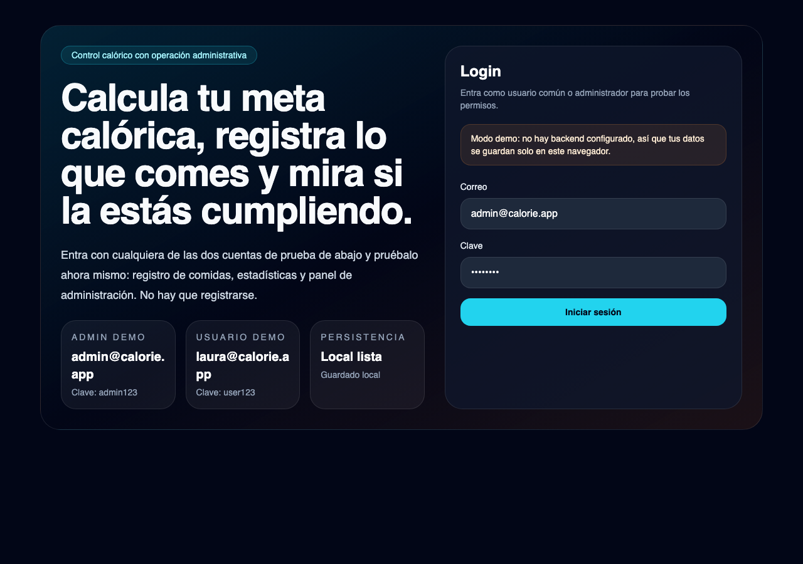

# Calorie Smart

Contador de calorías con metas personalizadas. Calcula tu gasto energético a
partir de tu perfil, te propone una meta diaria y registra lo que comes para
ver si la estás cumpliendo.

### ▶ Pruébalo: **<https://gibson1987r.github.io/calorie-smart/>**

Entra con **`admin@calorie.app` / `admin123`** (administrador) o
**`laura@calorie.app` / `user123`** (usuario). No hay que registrarse: sin
backend configurado la app corre completa contra el `localStorage` de tu
navegador.

[](https://gibson1987r.github.io/calorie-smart/)

**Stack:** React 18 · Vite · Tailwind CSS · Firebase Auth · Supabase (PostgreSQL)

---

## La decisión que vale la pena contar: que funcione sin backend

La app usa Firebase Auth y Supabase, pero **ninguno de los dos es obligatorio**.
Cada cliente comprueba primero si tiene configuración
(`firebaseConfigurado`, en `src/lib/firebase.js`) y, si no la tiene, la app cae
a una capa de persistencia contra `localStorage` con los mismos métodos.

No lo hice por elegancia: lo hice porque **una demo que exige credenciales no es
una demo**. Quien abre el enlace desde mi perfil tiene diez segundos de
paciencia, no diez minutos para crear un proyecto de Firebase. Con esto, el
mismo código sirve para enseñarlo y para desplegarlo de verdad: se le ponen
las variables de entorno y usa el backend real, sin tocar una línea.

**Lo que costó:** cada operación de datos tiene que existir dos veces, una por
capa, y las dos tienen que mantenerse en paralelo. Es deuda real. La acepté
porque el modo demo es lo que hace que el proyecto se pueda enseñar.

---

## Qué hace

- **Meta calórica personalizada.** Calcula la tasa metabólica basal con la
  fórmula de Mifflin-St Jeor, la ajusta por nivel de actividad (5 niveles, de
  sedentario a muy activo) y por objetivo (perder −500 kcal, mantener,
  aumentar +300 kcal), con un piso de seguridad de 1200 kcal/día.
- **Registro diario por momento.** Desayuno, almuerzo, cena y snack, agrupado
  por fecha local.
- **Búsqueda nutricional automática.** Consulta las APIs de Edamam y
  Nutritionix para estimar las calorías de un alimento escrito en lenguaje
  natural, con captura manual como alternativa.
- **Dashboard de estadísticas.** Consumo frente a meta, plan semanal y
  sugerencias de menú generadas a partir del margen calórico restante.
- **Autenticación con Google** vía Firebase, y panel de administración para
  gestionar usuarios y sus metas.
- **Modo demo.** Si no configuras backend, la app funciona completa contra
  `localStorage`. No necesitas credenciales para probarla.

## Puesta en marcha

```bash
git clone https://github.com/Gibson1987R/calorie-smart.git
cd calorie-smart
npm install
npm run dev
```

Abre `http://localhost:5173`. Sin archivo `.env` arranca en **modo demo** con
datos locales.

### Configuración opcional

Copia `.env.example` a `.env` y rellena solo lo que quieras activar:

| Bloque | Variables | Para qué |
|---|---|---|
| Firebase | `VITE_FIREBASE_*`, `VITE_ADMIN_EMAILS` | Login con Google y persistencia en Firestore |
| Supabase | `VITE_SUPABASE_URL`, `VITE_SUPABASE_ANON_KEY` | Persistencia en PostgreSQL |
| Nutrición | `VITE_EDAMAM_*`, `VITE_NUTRITIONIX_*` | Búsqueda automática de calorías |

Cada bloque es independiente: la app degrada con elegancia si falta alguno.

- Esquema de base de datos: [`db/schema.sql`](db/schema.sql)
- Reglas de Firestore: [`firebase.rules`](firebase.rules)
- Guía de producción con Firebase: [`PRODUCTION_SETUP.md`](PRODUCTION_SETUP.md)

## Scripts

```bash
npm run dev      # servidor de desarrollo
npm run build    # build de producción en dist/
npm run preview  # previsualizar el build
```

## Estructura

```
src/
  App.jsx                      Estado global y orquestación
  components/
    FormularioComida.jsx       Alta de consumos
    DashboardEstadisticas.jsx  Meta vs. consumo, plan semanal
    LoginPanel.jsx             Autenticación
    ListaUsuarios.jsx          Panel de administración
  lib/
    calorias.js                TMB, meta diaria, plan semanal, menús
    nutritionApi.js            Clientes de Edamam y Nutritionix
    storage.js                 Persistencia local y sincronización
    firebase.js                Inicialización y auth
    firebaseData.js            Lectura/escritura en Firestore
    supabaseClient.js          Cliente de Supabase
db/schema.sql                  Tablas metas y consumos
```

## Notas

Los cálculos calóricos son estimaciones basadas en fórmulas estándar y no
sustituyen el criterio de un profesional de la nutrición.

## Licencia

[MIT](LICENSE)
